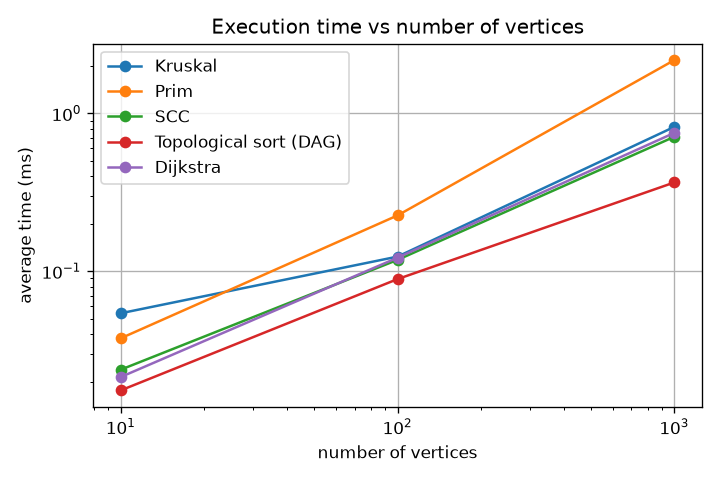
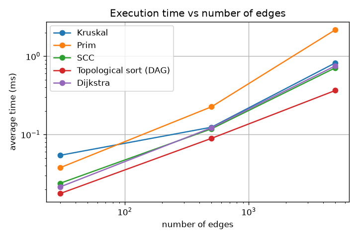
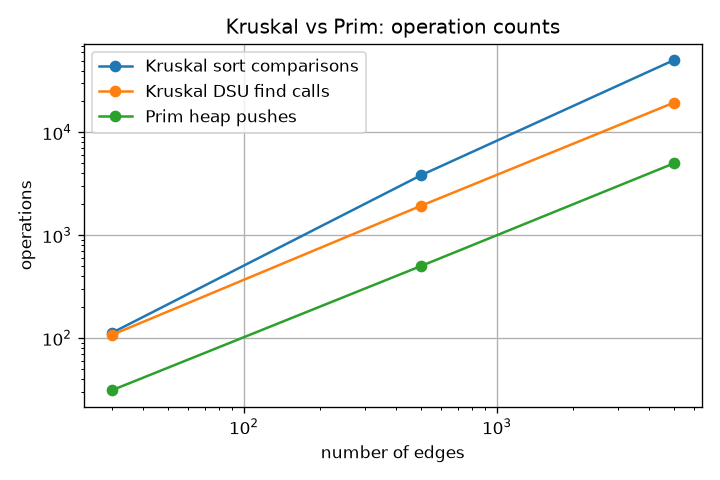

# Assignment 3 - Smart City Infrastructure and Route Planning

A Java program that models a city as a graph (districts = vertices, roads = edges). It has DSU, Kruskal, Prim, SCC (Kosaraju), topological sort (Kahn) and Dijkstra.

## How to run

```bash
mkdir -p out
javac -d out $(find src -name "*.java")

java -cp out Main
java -cp out tests.AllTests
java -cp out experiments.Benchmark results/tables
python3 scripts/make_report.py
```

`Main` is a small demo, `AllTests` runs the tests, `Benchmark` writes the csv files to `results/tables` and `make_report.py` (needs matplotlib) makes the plots in `results/plots`.

## 1. Overview

The graph is a `Graph` class with `V` vertices and a list of `Edge(u, v, weight)`. The edge list is used by Kruskal. For the other algorithms `Graph.adjacency(directed)` makes an adjacency list. MST uses the graph as undirected (two-way roads), and SCC, topological sort and Dijkstra use it as directed (one-way roads, dependencies).

The algorithms also have counters (comparisons, heap pushes, edge scans...) that I use in the experiments.

## 2. Implementation

- **DSU:** `parent` and `size` arrays, path compression in `find`, union by size. `union` returns `false` if both elements are in the same set.
- **Kruskal:** sort the edges, call `union` for each edge, take the edge if it returns `true`. If the MST has less than `V-1` edges, the graph is disconnected.
- **Prim:** `PriorityQueue` of `{vertex, weight}`. A vertex can be added many times, if it is already visited when taken out, I skip it. Starts at vertex 0.
- **Disconnected graph:** Kruskal and Prim print a message and return `-1`.
- **SCC:** Kosaraju with recursive DFS. First DFS gives the finish order, then DFS on the reversed graph in that order. Each tree is one SCC.
- **Topological sort:** Kahn's algorithm with in-degrees. If fewer than `V` vertices are taken out there is a cycle and it returns `null`.
- **Dijkstra:** priority queue, a `parent` array for the paths, unreachable vertices have distance `INF`. Negative weights throw an exception.

## 3. Complexity Analysis

I assume an adjacency list and a binary heap.

| Algorithm | Time | Space |
|---|---|---|
| DSU find / union | O(α(n)) amortized | O(n) |
| Kruskal | O(E log E) = O(E log V) | O(V + E) |
| Prim | O(E log V) | O(V + E) |
| SCC | O(V + E) | O(V + E) |
| Topological sort | O(V + E) | O(V + E) |
| Dijkstra | O((V + E) log V) | O(V + E) |

- **DSU:** union by size keeps trees at height log n, and path compression flattens the path after each `find`. Together it is almost constant (α(n) is at most 4).
- **Kruskal:** sorting E edges is the biggest part, the DSU part is only O(E α(V)). So it depends mostly on E.
- **Prim:** each edge is pushed once, each push/pop costs O(log V).
- **SCC and topological sort:** every vertex and edge is visited a constant number of times (SCC scans each edge twice, topological sort once).
- **Dijkstra:** at most E pushes into the heap, each O(log V).

**Why Dijkstra fails with negative weights:** it marks the closest vertex as final, thinking a later edge can not make the path shorter. Example: `s->a` = 2, `s->b` = 5, `b->a` = -4. Dijkstra finishes `a` with 2, but `s->b->a` = 1. For negative weights Bellman-Ford is needed.

## 4. Experimental Setup

Graph sizes: Small V=10, E=30. Medium V=100, E=500. Large V=1000, E=5000.

- Every graph uses `new Random(2024)` and weights from 1 to 100, no self-loops, no parallel edges.
- **MST:** a random spanning tree plus random extra edges, so the graph is always connected.
- **SCC and Dijkstra:** random directed graph. It has cycles (fewer SCCs than vertices), and some vertices are not reachable from vertex 0.
- **Topological sort:** a DAG (edges always go from the smaller to the bigger vertex number) and a cyclic graph (a ring through all vertices plus random edges).
- **Time:** 20 warm-up runs, then 5 runs timed with `System.nanoTime()`. The table shows the average in ms. Building the adjacency list and sorting are included.

Computer: Intel i5-12450HX, WSL2 Ubuntu 24.04, OpenJDK 17.

## 5. Results

**Kruskal vs Prim**

| V | E | Kruskal (ms) | Prim (ms) | sort comparisons | DSU find calls | DSU unions | Prim pushes |
|---:|---:|---:|---:|---:|---:|---:|---:|
| 10 | 30 | 0.0542 | 0.0376 | 112 | 107 | 30 | 31 |
| 100 | 500 | 0.1238 | 0.2256 | 3,825 | 1,931 | 500 | 501 |
| 1,000 | 5,000 | 0.8207 | 2.1723 | 50,490 | 19,468 | 5,000 | 5,001 |

**SCC and topological sort**

| V | E | SCC (ms) | SCC edge scans | SCCs | topo DAG (ms) | DAG edge scans | topo cyclic (ms) | cycle found |
|---:|---:|---:|---:|---:|---:|---:|---:|---:|
| 10 | 30 | 0.0238 | 60 | 2 | 0.0176 | 30 | 0.0120 | yes |
| 100 | 500 | 0.1180 | 1,000 | 4 | 0.0892 | 500 | 0.1243 | yes |
| 1,000 | 5,000 | 0.7103 | 10,000 | 19 | 0.3649 | 5,000 | 0.1902 | yes |

**Dijkstra** (source 0)

| V | E | time (ms) | relaxations | heap pushes | reachable vertices |
|---:|---:|---:|---:|---:|---:|
| 10 | 30 | 0.0214 | 10 | 11 | 9 |
| 100 | 500 | 0.1218 | 135 | 136 | 98 |
| 1,000 | 5,000 | 0.7518 | 1,438 | 1,439 | 992 |





In my graphs V and E grow together, so the first two plots look almost the same.

## 6. Comparison and Discussion

- **Kruskal vs Prim:** same MST weight every time. Prim is a little faster on the small graph, but Kruskal is faster on the large one (0.82 ms vs 2.17 ms). Both are O(E log V) in theory, but my Prim builds a bigger adjacency list and pushes every edge into the heap, while Kruskal just sorts an array. The counts match the theory: Prim has E + 1 pushes and Kruskal has about E log E comparisons.
- **DSU:** for E = 5,000 there are only 19,468 `find` calls (about 4 per edge), much less than the 50,490 sort comparisons. So the DSU is cheap, as expected from path compression and union by size. I did not test a DSU without them, so I cannot show a real speedup number.
- **SCC:** the edge scans are exactly 2E and the time grows about 6 times when the graph grows 10 times, so it is roughly linear.
- **Topological sort:** edge scans are exactly E for a DAG, and it is faster than SCC. Graphs with a cycle were always detected. At V=100 the cyclic time is higher than the DAG time, but this is only noise.
- **Dijkstra:** relaxations (1,438) are much smaller than E (5,000), so most of the time goes to scanning edges and not to the heap.
- **Theory vs experiments:** the counts match the theory well. The times are noisy (JIT, garbage collector), and I only used 3 sizes, one seed and 5 runs, so they show a trend and not exact numbers.

## 7. Testing

`java -cp out tests.AllTests` runs 46 checks and all pass (the "Graph is disconnected!" message is normal).

- small graphs with known results (MST weight 6, shortest distances, 4 SCCs)
- disconnected graphs (Kruskal and Prim return -1)
- graphs with cycles (cycle found in topological sort, ring is one SCC)
- many valid MSTs and duplicate weights (triangle with equal weights)
- unreachable vertices (distance `INF`, empty path)
- single vertex graphs
- negative weight (Dijkstra throws an exception)
- required sizes: Kruskal = Prim, valid order for DAGs, cycle detected, every vertex in exactly one SCC
- 100 random graphs: Kruskal = Prim, valid topological order for random DAGs

## 8. Conclusion

- DSU makes Kruskal fast.
- Kruskal and Prim give the same result. Kruskal was faster in my tests, Prim is good when the graph is stored as neighbours.
- SCC and topological sort are O(V + E). SCC finds groups of districts that reach each other, topological sort orders dependencies and finds cycles.
- Dijkstra gives shortest routes for non-negative weights. For negative weights use Bellman-Ford, for equal weights BFS is enough.
